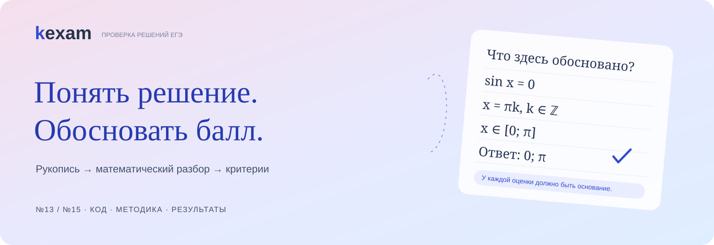
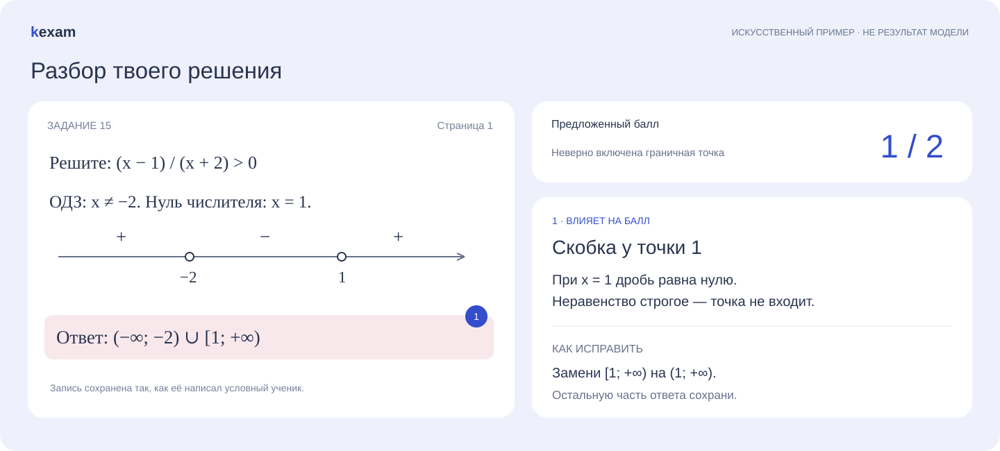
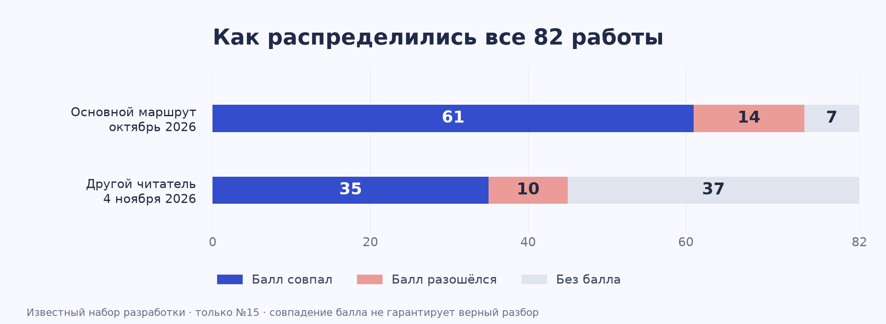

<p align="center"></p>

<p align="center">
  <a href="https://kexam.ru">Сайт проекта</a> ·
  <a href="docs/architecture.md">Как устроена проверка</a> ·
  <a href="docs/evaluation.md">Результаты и ограничения</a> ·
  <a href="docs/getting-started.md">Запустить локально</a>
</p>

# kexam

[](https://github.com/keksenia/kexam/actions/workflows/checks.yml)

Проверка рукописных решений второй части ЕГЭ по профильной математике. Ученик получает предложенный балл, объяснение по критериям и замечания к конкретным записям. Преподаватель может проверить основание и принять решение.

Я делаю kexam, потому что при проверке домашки много времени уходит на восстановление хода решения. Нужно понять почерк, заметить неверный переход, отделить его последствия от новых ошибок и применить критерии. Верный ответ в последней строке ещё не отвечает на эти вопросы.

Сейчас в рабочем ядре — **№13 и №15 в нумерации ЕГЭ-2026**. У продукта есть сайт, локальное приложение и опыт проверки школьной пачки. Оценки ИИ пока требуют приёмки преподавателем. Название ядра в коде — EGEChecker.

## Что увидит ученик



Это специально составленный пример интерфейса. Реальных работ учеников в репозитории нет. [Сайт kexam.ru](https://kexam.ru) показывает продукт; исходники этого репозитория относятся к ядру проверки и сами по себе не разворачивают сайт.

## Как проходит проверка

1. Пользователь выбирает задачу, добавляет условие и все страницы решения. Условие вводится текстом **либо** фотографией. Сохранение работы не вызывает модель.
2. Отдельный запрос решает задачу по одному условию. Решение ученика и эталонная оценка в него не попадают.
3. Читатель распознаёт ученические записи: формулы, рисунки, зачёркивания и неясные места. Он не получает решение первого запроса.
4. Оценщик сопоставляет условие, самостоятельное решение и буквальное чтение с критериями и предметными правилами. Возвращает балл, основание и замечания по строкам.
5. Код проверяет формат, диапазон балла и ссылки на записи. Все этапы сохраняются. Существенное сомнение остаётся вопросом, а не превращается в ноль.

В рабочем маршруте самостоятельное решение и оценку выполняет DeepSeek, чтение — Gemini. Для фото условия есть отдельное чтение. Названия моделей и настройки в файлах относятся к снимку проекта; менять их без повторной проверки качества нельзя. Новые варианты читателя исследуются отдельно. [Подробная схема →](docs/architecture.md)

## Что получилось измерить

На известной школьной пачке из **82 работ по №15 / 93 фотографий** основной маршрут выдал **75 числовых баллов**, **61** совпал с принятым эталоном. Это **81,3% среди оценённых** и **74,4% от всех работ**. Семь случаев остались без балла.



| На тех же 82 работах | Основной маршрут, октябрь | Опыт с читателем DeepSeek, 4 ноября |
|---|---:|---:|
| Получен числовой балл | 75 / 82 | 45 / 82 |
| Балл совпал с эталоном | 61 / 75 · **81,3%** | 35 / 45 · **77,8%** |
| Совпадения от всей пачки | **74,4%** | **42,7%** |
| Остались без балла | 7 | 37 |

Это материал разработки, который мы уже разбирали. Эталон — принятые мной финальные оценки, а не новая независимая экзаменационная экспертиза. Результаты относятся к конкретным историческим запускам, а не ко всем последующим изменениям кода. Полная сверка также нашла неточности чтения или пояснений в **13 работах с совпавшим баллом**. Поэтому совпадение оценки и качество всего разбора измеряем отдельно.

[Методика, состав набора и все оговорки →](docs/evaluation.md) · [Агрегаты в JSON →](benchmarks/school-82.json)

## Что здесь пришлось проработать

**Критерии и пограничные случаи.** Для №13 важны обоснование решения и отбора корней, для №15 — преобразования, ограничения и итоговое множество. Подготовлен каталог из **97 типов ошибок и недостатков решения**: с условиями подтверждения, исключениями и похожими случаями. Сам каталог не измеряет, насколько хорошо модель различает эти типы. [Предметная методика →](docs/methodology.md)

**Связь с исходной записью.** Замечание ссылается на существующую строку. Ученическая ошибка, недостаток обоснования и неуверенность системы различаются. Нельзя дорисовать ученику доказательство, исправить знак по смыслу или выдать предположение читателя за факт.

**Границы точных вычислений.** В проекте есть восемь операций для корней, точек окружности, множеств и знаменателей. Они проверяют формализованное утверждение в известном контексте. В основной модельный маршрут этот набор пока не подключён. Отдельная ограниченная проверка условия уже используется. [Где помогает код →](docs/architecture.md#точные-проверки)

**Продолжение после сбоя.** Полученное чтение и решение сохраняются. Адресное продолжение может использовать их без повторной оплаты; исходная попытка остаётся в истории. Слепых платных повторов нет, неизвестный расход останавливает новые обращения.

**Проверяемые границы результата.** Для подробной схемы есть контракт M01; текущая оценка использует более простой `independent-1`. Код проверяет структуру и согласованность ссылок. Математическую истинность ответа модели эта проверка не удостоверяет.

[Ключевые решения и чему научили эксперименты →](docs/decisions.md)

## Куда смотреть в коде

| Если интересно… | Начать здесь |
|---|---|
| Путь одной новой работы | [app/independent_checking.py](app/independent_checking.py) |
| Что получает решатель и оценщик | [app/independent_assessment.py](app/independent_assessment.py), [промпты](app/independent_prompts/) |
| Буквальное чтение и его границы | [app/independent_reading.py](app/independent_reading.py), [app/strict_reading.py](app/strict_reading.py) |
| Критерии и различение ошибок | [docs/methodology.md](docs/methodology.md), [каталог](planning/error_types_2026-10-10/CATALOG.md) |
| Проверка условия кодом | [app/condition_precheck.py](app/condition_precheck.py) |
| Точные математические операции | [exact_checks/](exact_checks/) |
| Проверки расходов и повторов | [app/call_guard.py](app/call_guard.py) |
| Продолжение сохранённой попытки | [app/check_continuation.py](app/check_continuation.py) |
| Контракт данных и валидатор | [contracts/ege_v1/](contracts/ege_v1/) |
| Бесплатные проверки на искусственных данных | [app/tests/](app/tests/), [инструкция](docs/getting-started.md) |

В `planning/` оставлены только данные, которые использует код: критерии, каталоги, схемы и синтетические примеры. Внутренние бэклоги и журналы сюда не переносились. [Полная карта репозитория →](docs/repository-map.md)

## Попробовать без API

В публичной среде прошли **748 технических тестов**; ещё 20, зависящих от исключённых исторических материалов, явно пропущены. Это проверка кода и границ данных, а не точности моделей. [Свидетельство запуска](benchmarks/technical-validation.json)

```sh
python3 -m venv .venv
source .venv/bin/activate
python -m pip install -r requirements.txt
python scripts/setup_runtime.py
python scripts/check.py
python scripts/demo.py
python -m app.server --port 8766
```

Локальный интерфейс: <http://127.0.0.1:8766>. Можно сохранить искусственную работу и посмотреть устройство приложения. Платная проверка в публичной поставке закрыта: ключей, журнала и действующих разрешений здесь нет. Демонстрация и тесты работают с искусственными ответами, без запросов к моделям. [Подготовка среды и границы воспроизводимости →](docs/getting-started.md)

## Автор

[Ксения Егорова](https://github.com/keksenia). Продукт, методика проверки и разработка kexam.

Публичный снимок подготовлен **5 ноября 2026**. [Состав и происхождение](RELEASE.json) · [Данные и приватность](docs/privacy.md) · [Условия использования материалов](NOTICE.md)
