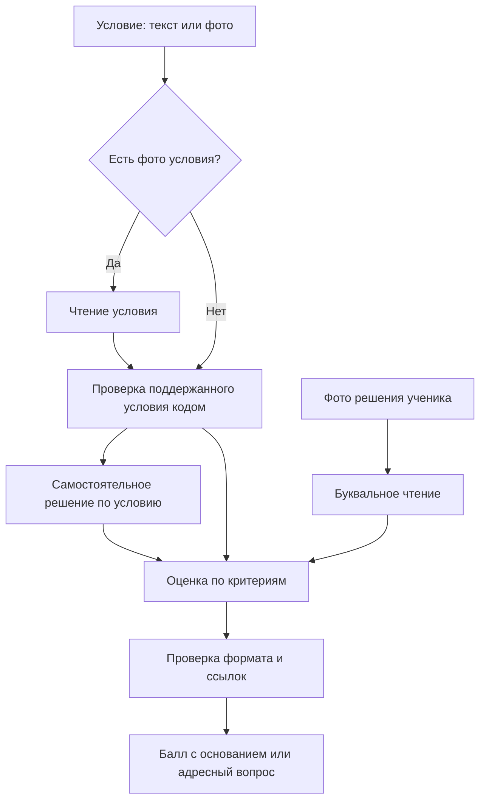

# Как устроено ядро проверки

Одна проверка относится к одной задаче. В ней сохраняются условие, страницы решения и результаты каждого этапа. Исторический результат не переписывается при изменении промпта или конфигурации.



Стрелки показывают передачу данных. В текущем исполнителе этапы проходят последовательно; рисунок не обещает параллельных запросов.

## Условие и самостоятельное решение

Текст принимается буквально. Фотография сначала читается отдельно. Для нового ввода два источника одновременно запрещены, чтобы не возникало двух расходящихся условий.

`condition_precheck.py` передаёт поддержанную математическую запись отдельному процессу SymPy с ограничением времени. Явное противоречие типу задания или конкретное математическое подозрение может остановить следующие этапы. Неподдержанная формула передаётся модели; отсутствие кодового ответа не доказывает ошибку условия.

Самостоятельный решатель получает только условие. Его текст сохраняется без математического исправления. Для формул не требуется упаковка внутри модельного JSON: она уже приводила к техническим отказам из-за экранирования. Это решение служит ориентиром для оценщика и тоже может содержать ошибку.

## Чтение работы

Читатель видит фотографии и инструкции чтения. Самостоятельное решение и принятый балл ему не передаются. Он сохраняет видимые формулы, рисунки, зачёркивания, альтернативные чтения и конкретные неразборчивые участки.

Полнота комплекта фотографий, читаемость изображения и объём написанного учеником — разные признаки. Полностью прочитанный лист с одним ответом можно оценивать. Потерянную или неразборчивую страницу нельзя объявить пустым решением.

Рабочий маршрут использует структурированное чтение. Поздние опыты со свободным текстом и несколькими версиями чтения не заменили его автоматически. Их выводы описаны в [решениях](decisions.md).

## Оценщик и результат

Оценщик получает условие, самостоятельное решение, буквальное чтение, критерии и каталог ошибок. Если есть кодовый ориентир, вместе с ним передаётся точная формула, по которой он получен, и область применимости. Проверка пункта а не доказывает пункт б.

Текущий формат ответа:

```json
{
  "score": null,
  "reason": "Не установлено, включена ли граничная точка в ответ ученика.",
  "errors": [
    {
      "line": "1:4",
      "type": "system_uncertainty",
      "explanation": "Скобка на фотографии читается неоднозначно.",
      "criterion": "От этой записи зависит применение критерия.",
      "hint": "Уточните только скобку у правой границы."
    }
  ]
}
```

Пример составлен для документации. `score` принимает 0, 1, 2 или `null`. Ссылка `1:4` допустима только при существовании соответствующей записи. Код проверяет форму, типы и ссылки. Он не устанавливает истинность объяснения и не достраивает доказательства.

В приложении оболочка `independent-1` добавляет чтение, самостоятельное решение и отпечаток входа. Контракт M01 в `contracts/ege_v1/` используется для чтения, прежних результатов и отдельной офлайн-диагностики. Это разные представления с разными границами.

## Точные проверки

В `exact_checks/` реализованы восемь операций: принадлежность корня промежутку, отбор корней из серий, равенство точек окружности, объединение/пересечение множеств, принадлежность множеству, равенство множеств и ненулевой знаменатель.

Они используют точные дроби и явно заданные границы. Для каждого аргумента нужны источник, действующая ветвь и установленные предпосылки. Операция может вернуть `unknown`, если чтение неоднозначно или задача вне её области. Вычисление на неверно прочитанной формуле не подтверждает работу ученика.

Набор подключён к офлайн-диагностике `app/pipeline.py`, но **не подключён целиком к основному маршруту модельной оценки**. В живом пути действует отдельная ограниченная проверка условия. Реестр и синтетические примеры: [planning/k01/](../planning/k01/).

## Расходы, сохранение и продолжение

Перед каждым платным обращением `call_guard.py` проверяет разрешённые параметры, бюджет, число запросов и состояние учёта. Ответ и стоимость сохраняются отдельно от математической оценки. Неизвестная стоимость сохраняется неизвестной и блокирует новые обращения до урегулирования.

Слепых и технических автоматических повторов нет. Одно адресное перечитывание фото условия возможно по конкретному подозрению, если оно прямо предусмотрено допуском и лимитом. После явного адресного действия `check_continuation.py` может повторно использовать принятые этапы, сверенные с сохранёнными запросами и ответами. Уточнение человека хранится отдельно от ученической записи. Старый job и расходы остаются в истории.

Публичный снимок не содержит действующей policy, журнала, разрешений на передачу фото или ключей. Сервер слушает `127.0.0.1`, проверяет Host/Origin и предназначен для локального использования.
